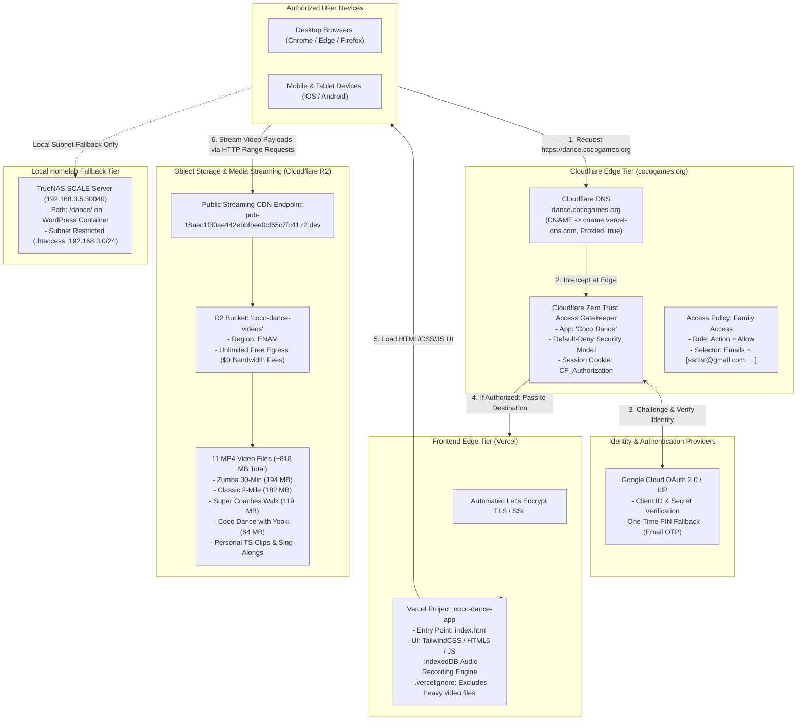

# Sing & Dance Video Player (`dance.cocogames.org`) Infrastructure & Architecture

This document describes the cloud edge topology, Zero Trust access security, DNS routing, and application streaming architecture for **Coco Sing & Dance** ([https://dance.cocogames.org](https://dance.cocogames.org)).

---

## 1. Global End-to-End System Diagram



---

## 2. Ingress, Security & Routing Specifications

| Component | Target / Value | Configuration | Functionality |
| :--- | :--- | :--- | :--- |
| **Public URL** | `https://dance.cocogames.org` | Canonical FQDN | Protected family edutainment video player |
| **DNS Record** | `cname.vercel-dns.com` | `CNAME`, `proxied: true` | Routes traffic through Cloudflare Edge Anycast IPs |
| **Zero Trust App** | `Coco Dance` | Self-Hosted Application | Edge authentication interception before Vercel or media load |
| **Access Policy** | `Family Access` | `Action: Allow`, `Selector: Emails` | Email allowlist validation (`ssrtist@gmail.com`, etc.) |
| **Frontend Host** | Vercel (`coco-dance-app`) | Static Edge Deployment | Serves HTML5 interface, lyrics synchronization, IndexedDB recorder |
| **Video Storage** | Cloudflare R2 (`coco-dance-videos`) | `Standard`, `ENAM` | High-throughput byte-range video streaming with $0 egress fees |
| **Local Fallback** | `http://192.168.3.5:30040/dance/` | Apache / TrueNAS SCALE | Subnet-fenced local server for offline/LAN use |

---

## 3. Storage Architecture: 11 Hosted Video Payloads

| Video Title | Cloudflare R2 Filename | Size | Resolution |
| :--- | :--- | :---: | :---: |
| Zumba 30-Minute Mini-Workout | `Zumba 30-Minute Mini-Workout_720p.mp4` | 194.0 MB | 720p |
| Classic 2 Mile Workout | `Classic 2 Mile Workout_720p.mp4` | 181.8 MB | 720p |
| Walking Exercise with SUPER Coaches | `Walking Exercise with the SUPER Coaches_720p.mp4` | 119.4 MB | 720p |
| Coco Dance with Yooki | `Coco Dance App 2 of 2 - Dance.mp4` | 84.3 MB | 1080p |
| Let It Be (Personal Clip) | `PXL_20250514_193032889.TS.mp4` | 52.0 MB | 1080p |
| My Bonnie (Personal Clip) | `PXL_20250528_190856971.TS.mp4` | 42.7 MB | 1080p |
| Brave (Personal Clip) | `PXL_20250625_194342335.TS.mp4` | 40.2 MB | 1080p |
| True Colors (Personal Clip) | `PXL_20250528_194505329.TS.mp4` | 38.8 MB | 1080p |
| I Can See Clearly Now | `I Can See Clearly Now_720p.mp4` | 31.9 MB | 720p |
| My Bonnie Lies Over The Ocean | `My Bonnie Lies Over The Ocean_1080p.mp4` | 25.9 MB | 1080p |
| Golden Girls Theme | `Golden Girls_720p.mp4` | 7.6 MB | 720p |
| **Total Media Size** | **11 Video Files** | **~818.5 MB** | **Streaming from R2** |

---

## 4. Operational Maintenance & Deployments

1. **Deploy Frontend Code Changes**:
   ```powershell
   python C:\Users\kenny\.gemini\skills\vercel\scripts\vercel_client.py deploy "C:\working\git-repos\coco-video-player" --project coco-dance-app --prod
   ```
2. **Push Upstream Repository**:
   ```powershell
   git -C "C:\working\git-repos\coco-video-player" push origin main
   ```
3. **Add New Videos**:
   - Upload new MP4 files to Cloudflare R2 bucket `coco-dance-videos`.
   - Update `videoData` in `index.html` referencing `https://pub-18aec1f30ae442ebbfbee0cf65c7fc41.r2.dev/<filename>.mp4`.
   - Run the deploy script above.
